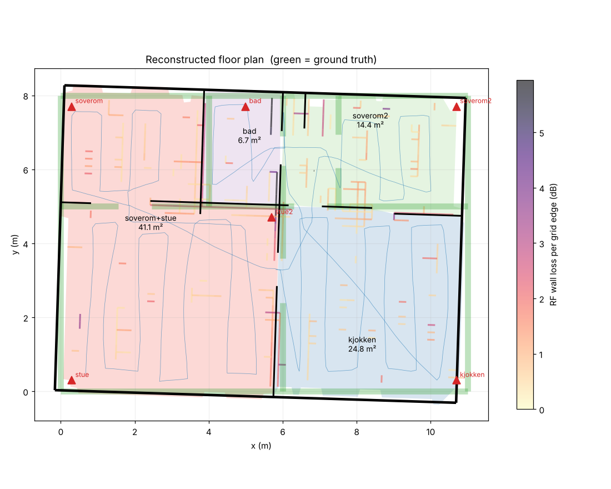

# rf-home-mapper (`rfhome`)

Lager en plantegning og en enkel 3D-modell av et hjem ut fra **signalstyrke (RSSI)** mellom
faste ESP32-noder og en telefon/beacon du går rundt med, kombinert med **hvor du gikk**.
Utdata: `floorplan.json`, `home.obj`, `home.gltf`, en 3D-visning i nettleseren (`home.html`)
og et 2D-plott (`floorplan.png`).



*Typisk resultat på simulerte data (frø 1). Svart = rekonstruert, grønt = fasit. Veggen mellom
stue og soverom ble bare delvis funnet, derfor er de slått sammen til «soverom+stue».*

---

## Hva finnes på GitHub, og hvorfor dette bygger på ESPresense

Jeg gikk gjennom de mest relevante prosjektene (oktober 2026):

| Prosjekt | Hva det faktisk gjør | Lager det geometri (vegger/rom)? |
|---|---|---|
| [ruvnet/RuView](https://github.com/ruvnet/RuView) (~99k ★) | Tilstedeværelse, posisjon, puls/pust fra WiFi-CSI | **Nei.** «Environment mapping» er et RF-fingeravtrykk som kjenner igjen rom og oppdager endringer. Prosjektet har selv trukket tilbake tidligere nøyaktighetstall – vær kritisk. |
| [espressif/esp-csi](https://github.com/espressif/esp-csi) | Offisiell CSI-firmware og eksempler (bevegelse, tilstedeværelse) | Nei |
| [francescopace/espectre](https://github.com/francescopace/espectre) | CSI-bevegelsessensor for ESPHome/Home Assistant | Nei |
| [schollz/find3](https://github.com/schollz/find3) | Rom-nivå posisjonering med WiFi/BLE-fingeravtrykk | Nei (trenger trening per rom) |
| [ESPresense](https://github.com/ESPresense/ESPresense) + [companion](https://github.com/ESPresense/ESPresense-companion) | ESP32-noder som måler BLE-RSSI og sender over MQTT; companion trilaterer enheter | **Nei – plantegningen må du tegne selv** i `config.yaml` |
| [jonathanmuller/esp-ppb](https://github.com/jonathanmuller/esp-ppb) | Fasesynkroniserte ESP32 for innfallsvinkel (AoA) | Nei (forskning, interessant for fremtiden) |

**Konklusjon:** jeg fant ingen åpne prosjekter som lager en plantegning fra WiFi- eller BLE-signaler
i et vanlig hjem. Mange av dem kan si *at* noen er i et rom, men ikke *hvordan rommet ser ut*.
`rfhome` snur derfor ESPresense-oppsettet. I stedet for å tegne plantegningen for hånd og bruke den
til å finne telefonen, bruker den kjente telefonposisjoner og RSSI-målinger til å **finne veggene**.
Data kommer rett fra ESPresense over MQTT, men CSV-formatet er generelt (se under), så andre
RSSI-kilder kan også brukes.

## Hvordan det virker

1. **Måling.** 4–6 ESP32-noder med ESPresense står på kjente steder. Du går sakte gjennom hele
   boligen med telefonen. Hver mottatt pakke gir én *link*: sender, mottaker, RSSI og posisjonene
   til begge endene. Nodene måler også hverandre (node-til-node).
2. **Geometri fra gangen.** Der du har gått, finnes ingen vegg. Kanter du har gått gjennom, er
   åpne (dører). Smale striper du *ikke* har gått i, blir veggkandidater.
3. **Tynnvegg-radiotomografi** (`tomography.py`). Huset legges i et rutenett på 20 cm som er
   rotert etter husets retning. Hver kant i rutenettet kan ha et tap *x ≥ 0* i dB. Hver link gir
   én lineær ligning:

   `rssi = offset(node) − 10·n·log10(d) − b·kroppsskygge − Σ x(kanter linken krysser)`

   Kantene, node-offsetene, eksponenten *n* og kroppsdempingen *b* estimeres samtidig (FISTA med
   ikke-negativitet, L1 og kontinuitet langs vegglinjer). Dette er en variant av *Radio Tomographic
   Imaging* (Wilson & Patwari, IEEE TMC 2010) med multi-vegg-modellen (COST-231).
4. **Helvegg-tilpasning** (`refine.py`). Hver kandidatvegg og mulig forlengelse kuttes i biter på
   40 cm og tilpasses på nytt mot rådata. Svake biter fjernes (bakoverseleksjon). Her skilles ekte
   vegger fra striper som bare er mellomrom mellom gangbaner.
5. **Plantegning** (`extract.py`). Ytterkonturen gjøres om til et rettvinklet polygon. Vegger
   kobles i T- og L-skjøter, dører legges der du gikk gjennom en vegg, og rom finnes med
   morfologisk segmentering (watershed) og får navn etter nodene i dem.
6. **Eksport** (`export.py`). Veggene ekstruderes til 3D med dører og overligger (OBJ/glTF), og
   det lages en three.js-visning.

### Kroppsdemping
Når du går bort fra en node, står kroppen din mellom telefonen og noden. Det gir 5–10 dB ekstra
tap. Uten en egen modell for dette dukket det opp falske vegger mellom gangbaner som ble gått i
motsatt retning. Modellen estimerer derfor kroppsdempingen fra gåretningen.

## Nøyaktighet – målt på simulerte data

Simulatoren (`simulate.py`) lager en 11 × 8 m leilighet med 6 rom, 6 noder og en gangtur på
~2,5 min (0,8 m/s, 4 pakker/s per node). Den tar med vegger på 5–12 dB, kroppsdemping (4 dB),
romlig korrelert skyggefading (2 dB), rask fading (3 dB), RSSI i hele dB, en følsomhetsgrense og
glatt drift i posisjonssporingen (≈15 cm).

Tallene er snitt over 8 tilfeldige målinger. «Innvegger» betyr innerveggene. Et veggpunkt regnes
som riktig hvis det ligger innen 0,4 m fra fasit.

| Oppsett | Innvegger presisjon | Innvegger recall | Innvegger F1 | Median posisjonsfeil | Fotavtrykk IoU |
|---|---|---|---|---|---|
| **Full pipeline** | **0,95** | **0,85** | **0,90** | **0,14 m** | **0,93** |
| Uten helvegg-tilpasning | 0,87 | 0,74 | 0,80 | 0,13 m | 0,94 |
| Bare geometri (ingen radiobevis) | 0,44 | 0,94 | 0,60 | 0,14 m | 0,45 |
| Sporing med 30 cm feil (i stedet for 15) | 0,82 | 0,75 | 0,79 | 0,17 m | 0,91 |
| Sporing med 5 cm feil | 0,91 | 0,90 | 0,91 | 0,13 m | 0,94 |
| Mer radiostøy (fading 5 dB, skygge 3 dB) | 0,89 | 0,82 | 0,85 | 0,15 m | 0,94 |

**Rom:** i snitt ble 4,4 av 6 rom skilt korrekt. Når en vegg bare blir delvis funnet, slås to rom
sammen (de får navnet «a+b»). Den smale gangen er det rommet som oftest forsvinner.

Hva tabellen viser:
- Radiodataene gjør reell jobb. De løfter presisjonen fra 0,44 til 0,95 ved å forkaste striper som
  bare er mellomrom mellom gangbaner.
- Resultatet avhenger mest av **hvor godt posisjonen din spores**, mindre av radiostøyen.

## Begrensninger og hull i logikken – les dette

1. **Simuleringstallene er en øvre grense.** Simulatoren bruker samme modellfamilie (rette linjer
   og veggtap) som rekonstruksjonen. I et ekte hjem har du flerveis-refleksjoner, møbler,
   metallflater (kjøleskap, speil, radiatorer) og andre mennesker. Regn med dårligere resultater
   til modellen er validert mot et hjem med kjent plantegning. Det er **ikke gjort ennå**.
2. **Radio ser ikke ytterveggene.** Linker mellom punkter inne i huset krysser dem aldri.
   Ytterkonturen kommer fra hvor du gikk, pluss `--clearance` (hvor nær veggene du gikk, standard
   0,35 m). Går du langt fra veggene, blir huset for lite.
3. **Det meste av geometrien kommer fra gangen.** Radio avgjør hvilke ubesøkte striper som er
   vegger. Den kan ikke finne en vegg der du aldri har gått på noen av sidene.
4. **Bare rettvinklede vegger** (Manhattan-antagelse). Skrå vegger blir trapper eller går tapt.
   Husets retning estimeres fra gangen, og drift i sporingen kan vri planen rundt 1°.
5. **2,5D, ikke ekte 3D:** én etasje, fast takhøyde (`--height`), ingen vinduer eller møbler.
   Flere etasjer må måles og rekonstrueres hver for seg.
6. **Posisjonsoppløsning:** rutenettet er 20 cm, og veggen antas å stå midt i den ubesøkte stripen.
   Median feil i simuleringen er 0,1–0,15 m, men enkeltvegger kan bomme med 0,3 m.
7. **Vegger rett ved en node** er dårlig bestemt, fordi tapet kan forveksles med nodens offset.
   Gå tett inntil hver node på *begge* sider av nærmeste vegg.
8. **ESPresense glatter RSSI** i firmware. Det gir forsinkelse mens du går. Gå sakte (~0,5 m/s)
   eller bruk stopp-og-gå (`survey`).
9. **Klokkesynk:** ved kontinuerlig gange må telefonen og maskinen som logger MQTT ha samme klokke
   (NTP). 0,5 s feil ved 0,5 m/s gir 25 cm posisjonsfeil.
10. **Dører finnes bare der du gikk gjennom.** Lukkede dører måles som vegg, så ha alle dører åpne.
11. `tools/walker.html` (WebXR-logger for Android/Chrome) er **ikke testet på en ekte telefon**.
12. Vil du ha centimeter-nøyaktighet, er en LiDAR-skanner bedre, for eksempel iPhone Pro med Apples
    RoomPlan. Radiometoden passer når du vil slippe kamera, eller som et supplement.

## Komme i gang

```bash
cd rf-home-mapper
pip install -e ".[mqtt,dev]"
python -m pytest            # 19 tester, inkl. ende-til-ende på simulerte hjem
```

### Prøv uten maskinvare
```bash
python -m rfhome simulate --out sim --seed 1
python -m rfhome reconstruct sim --out model      # skriver også nøyaktighet mot fasit
# åpne model/home.html i nettleseren
```

### Ditt eget hjem
**Maskinvare:** 4–6 ESP32 med [ESPresense](https://espresense.com/) (flash fra nettleseren), en
MQTT-broker (f.eks. Mosquitto i Home Assistant) og en telefon som ESPresense ser (companion-appen
eller en BLE-beacon i lomma). Slå på node-til-node-måling i ESPresense-innstillingene.

1. **Plasser nodene** i ulike rom og mål posisjonene i meter fra et hjørne (`nodes.json`, se
   `examples/nodes.json`). Bruk samme navn som node-id-en i ESPresense.
2. **Mål**, på én av to måter:
   - *Stopp-og-gå* (ingen app nødvendig). Lag `waypoints.csv` (`name,x,y`, se eksempelet) med
     punkter i alle rom. Legg punktene slik at rette linjer mellom dem går gjennom døråpninger.
     ```bash
     python -m rfhome survey --host <mqtt-host> --waypoints waypoints.csv --nodes nodes.json \
            --walker <telefonens-espresense-id> --dwell 15 --out survey
     ```
     Snu deg sakte en runde på hvert punkt.
   - *Kontinuerlig gange* (gir best geometri). Logg posisjonen med `tools/walker.html` (eksperimentell)
     eller en annen AR-app som gir `t,x,y`, samtidig som du kjører:
     ```bash
     python -m rfhome record --host <mqtt-host> --out raw.csv
     python -m rfhome join --raw raw.csv --traj trajectory.csv --nodes nodes.json --walker <id> --out survey
     ```
     Gå i baner med ca. 0,8 m mellomrom over alle gulv, langs veggene og gjennom alle dører.
3. **Rekonstruer:**
   ```bash
   python -m rfhome reconstruct survey --out model --height 2.5
   ```
   `model/report.json` viser blant annet hvor mye veggene forklarer
   (`rms_residual_db` sammenlignet med `rms_residual_without_walls_db`), estimert kroppsdemping og
   arealet per rom.

### Andre signalkilder
Rekonstruksjonen leser bare `measurements.csv` (`t,a,b,rssi,ax,ay,bx,by`, der `a`/`b` er `walker`
eller en node-id), `trajectory.csv` (`t,x,y`) og `nodes.json`. RSSI fra WiFi, Zigbee eller Thread
kan brukes på samme måte, så lenge du vet posisjonene til begge endene.

## Kode

| Fil | Innhold |
|---|---|
| `rfhome/data.py` | Måleformat, lagring, aggregering, kroppsdemping-faktor |
| `rfhome/tomography.py` | Rutenett, kantkryssinger, tynnvegg-tomografi (FISTA), husretning |
| `rfhome/refine.py` | Helvegg-tilpasning med bakoverseleksjon |
| `rfhome/extract.py` | Ytterkontur, veggkandidater, skjøter, dører, romsegmentering |
| `rfhome/reconstruct.py` | Hele pipelinen |
| `rfhome/export.py` | PNG, OBJ, glTF, HTML-visning |
| `rfhome/simulate.py` | Syntetisk hjem og måling med fasit |
| `rfhome/evaluate.py` | Presisjon/recall for vegger, fotavtrykk-IoU, romareal |
| `rfhome/ingest.py` | ESPresense/MQTT, stopp-og-gå, sammenstilling på tidsstempel |
| `tools/walker.html` | WebXR-logger for gangbane og nodeposisjoner (eksperimentell) |

## Mulige neste steg
- Validere mot et ekte hjem med kjent plantegning, og kalibrere standardverdiene.
- Bruke CSI-amplitude per underbærer fra ESP32 (esp-csi) i stedet for RSSI. Det gir mer
  informasjon per pakke.
- Bruke WiFi FTM/RTT-avstander til å korrigere drift i posisjonssporingen.
- Støtte flere etasjer og skrå vegger.
